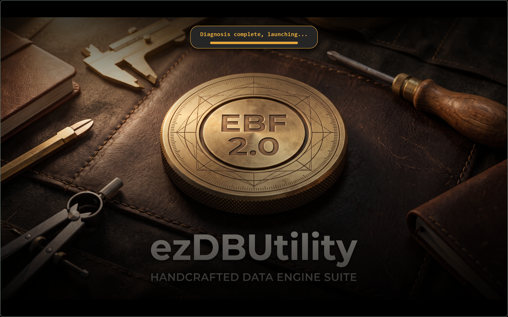
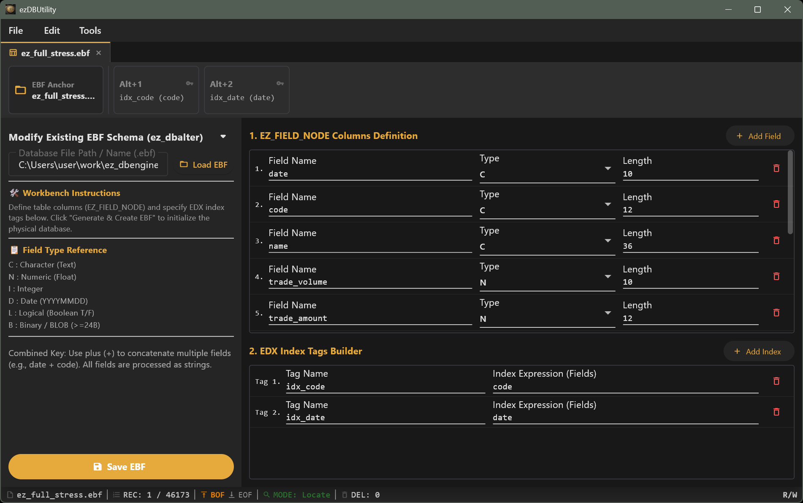
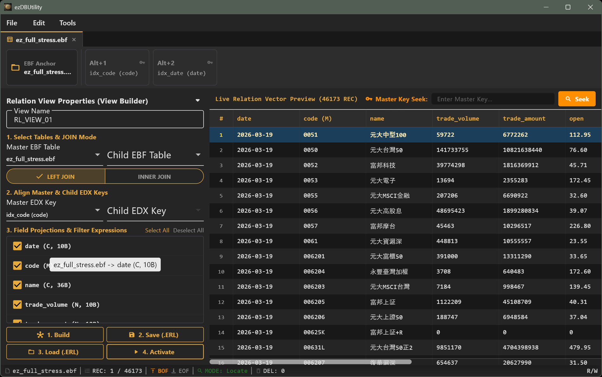
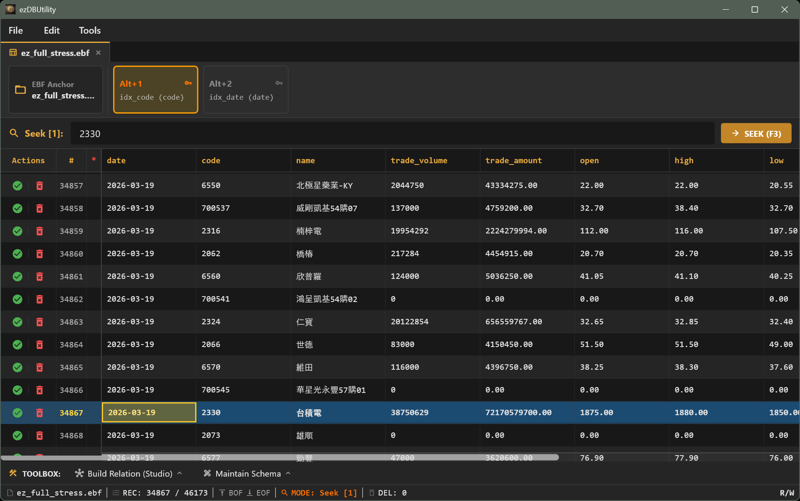
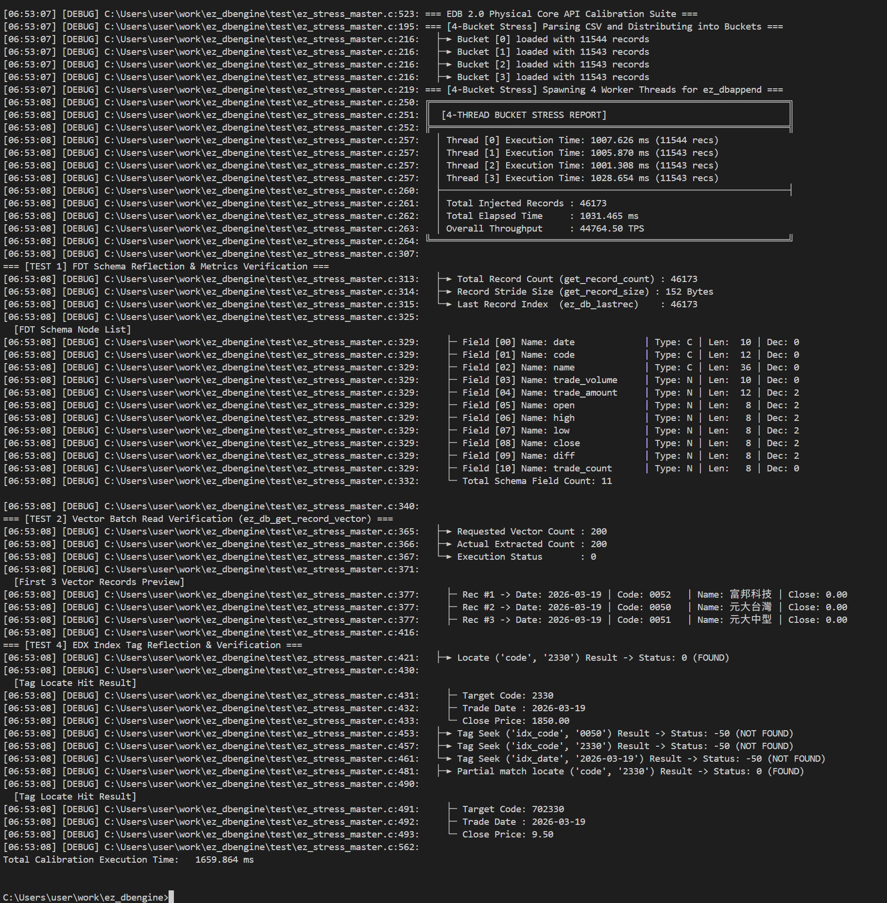
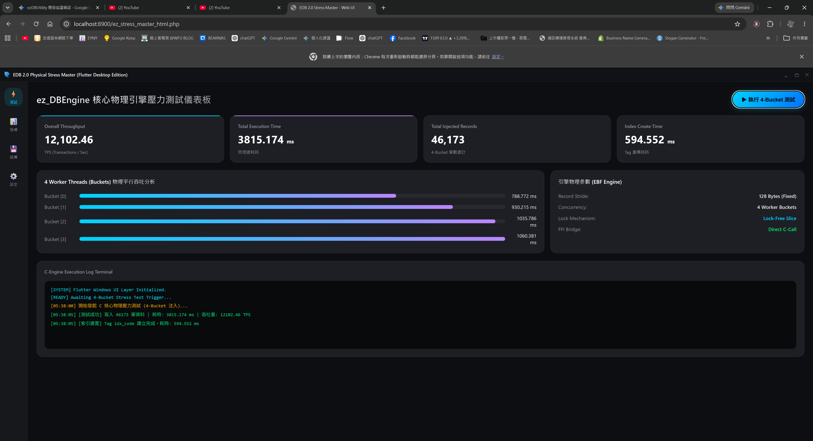

# ez_dbengine 0.9 🚀


**ez_dbengine** is a lightweight, high-performance database engine built with C. Engineered for bare-metal I/O throughput and seamless cross-platform FFI integration (such as Flutter/Dart, Python, and more), it is purpose-built for edge AI data processing and high-concurrency, lock-free backend workloads.

---

📄 **License**
Copyright (C) 2026 CHI HSIUNG YANG (楊啟雄). All rights reserved.

This software is proprietary and confidential. Unauthorized copying, distribution, modification, reverse engineering, or commercial exploitation without prior written consent from the copyright holder is strictly prohibited.

---

## ⚡ Key Highlights & Capabilities
Extreme I/O Throughput: Powered by native OS asynchronous dispatch engines (including Linux io_uring and Windows IOCP), maximizing hardware NVMe/SSD bandwidth.

Lock-Free Multi-Threaded Concurrency: Optimized for high-frequency concurrent read/write workloads without thread contention overhead.

Integrated Physical Indexing: Automatic index mounting and verification ensure high-speed O(log N) tag seeking without the risk of index desynchronization.

Universal FFI Ecosystem: Zero-copy bindings available out-of-the-box for Flutter/Dart, Python, C#, Node.js, Rust, PHP, and C++.

Built-in Relation Subsystem: Declarative multi-table JOIN view builder with compiled .ERL view schema support.

Visual Management Suite: Complete with ezDBUtility GUI and interactive ez_Shell CLI tools.

---


## 🎨 ezDBUtility (DBU) Visual Management Suite

The newly introduced GUI management suite **`ezDBUtility`** integrates database schema evolution, Tag index design, physical data grid editing, and Relation Studio multi-table join previews:

| Screen Name | Screen Preview | Feature Description |
| :--- | :---: | :--- |
| **Startup Splash Screen** |  | Loads the ez_dbengine core and performs environment checks. |
| **Schema & Tag Management** |  | Visually edit `EZ_FIELD_NODE` field types and multiple EDX index Tags. |
| **Relation Studio (View Builder)** |  | Declarative JOIN condition builder with custom vector projections and `.ERL` export support. |
| **Data Grid Entity Editor** |  | Supports fast location with `Ctrl+F`, row-level deletion (DEL), and highlight views. |
|  |  |  |
| **Web Schema Designer** |  | Visually edit `EZ_FIELD_NODE` field types and multiple EDX index Tags . |
| **Web Relation Studio** |  | Declarative JOIN condition builder with custom vector projections and `.ERL` export support. |
| **Main Editor** |  | Supports fast location with `Ctrl+F`, row-level deletion (DEL), and highlight views. |

---

## 🖥️ ez_Shell Interactive Console

Introducing the all-new GUI & Console management tool **`ez_Shell`**, designed to integrate database schema evolution, Tag index design, physical data grid editing, and Relation Studio multi-table JOIN previews:

| Screen Name | Screen Preview | Feature Description |
| :--- | :---: | :--- |
| **ez_Shell Interactive Console** |  | Operating the DBU in Console mode. |

---


## 🛠️ Cross-Platform FFI Interfaces & DBU Suite

`ez_dbengine` provides a complete DBU suite and multi-language bindings, enabling various tech stacks to seamlessly access the extreme physical performance of the underlying C engine:

```text
├── cpp/            # C++ Native Client & FFI Class Wrapper
├── cs/             # C# (.NET 9) P/Invoke SDK & DllImport Resolver
├── flutter/        # Flutter / Dart FFI GUI Dashboard (ezDBUtility)
├── node.js/        # Node.js (ffi-napi / koffi) Native Binding
├── php/            # PHP FFI Web Application & Admin Dashboard
├── python/         # Python ctypes High-Level Object Wrapper
└── rust/           # Rust Safe FFI Binding (RAII Drop & Struct Alignment)
```
---

## 📊 Multi-Language FFI Benchmark (4-Bucket Physical Ingestion)

All benchmarks are evaluated under the same 4-Bucket parallel ingestion and physical disk file writing (`daily_2026-03-19.csv`, 46,173 records):

| Language / Framework | Interface Mode | Total Records | Execution Time (ms) | Throughput (TPS) | Benchmark Screenshot |
| :--- | :--- | :---: | :---: | :---: | :---: |
| **C Core (Native)** | Direct C Call | 46,173 | **1,031.46 ms** | **44,764.50 TPS** |  |
| **C++ OO** | C++ Wrapper | 46,173 | **1,259.43 ms** | **36,661.79 TPS** |  |
| **Flutter / Dart** | Dart FFI Isolate | 46,173 | **1,612.16 ms** | **28,640.42 TPS** |  |
| **Python** | `ctypes` FFI | 46,173 | **2,138.12 ms** | **21,595.05 TPS** |  |
| **C# (.NET 9)** | P/Invoke Native | 46,173 | **2,764.37 ms** | **16,702.88 TPS** |  |
| **Node.js** | Native FFI | 46,173 | **3,328.90 ms** | **13,870.35 TPS** |  |
| **Rust** | Safe FFI Wrapper | 46,173 | **3,314.78 ms** | **13,929.41 TPS** |  |
| **PHP (Web UI)** | PHP FFI + Dash | 46,173 | **3,815.17 ms** | **12,102.46 TPS** |  |

### 🛠️ Optimization Roadmap for Language-Specific FFI Bindings

To further improve throughput for languages currently performing in the 23K–26K TPS range, upcoming releases will introduce lock-free and zero-copy refactoring:

#### 1. Rust SDK
- **Eliminate `CString` and `clone()` on Hot Paths**: Transition to raw byte slice pointers `&[u8]` (`as *const c_char`), completely avoiding 46K+ micro-heap allocations per run within inner loops.
- **Decouple External Synchronization Primitives**: Remove `Arc<Mutex<...>>` and leverage the C engine's native lock-free atomic reservation, allowing worker threads to append directly using isolated raw handles.
- **Enable Link-Time Optimization (LTO)**: Activate `lto = "fat"` and set `codegen-units = 1` in `Cargo.toml` to maximize compiler inlining and vectorization.

#### 2. Node.js (Koffi)
- **Contiguous Buffer Batch Injection**: Batch record sets per bucket into a single continuous `Buffer` before crossing the FFI boundary, minimizing V8 context switching overhead.
- **Multi-Threaded Worker Isolation**: Integrate `worker_threads` with `SharedArrayBuffer` to eliminate main event loop contention across cores.

#### 3. PHP (Web FFI)
- **Pre-Allocated Contiguous C Heap**: Allocate batch memory directly via `FFI::new("char[N]")` to avoid frequent Zend Engine `zval` allocations and garbage collection pressure.
- **Enable Opcache JIT**: Run with `-d opcache.enable_cli=1 -d opcache.jit=tracing` to compile high-frequency FFI loops directly into native assembly.

---

## 💡 Core Philosophy

### 1. Intuitive Data Operation Semantics
Eliminate tedious SQL query assembly and complex ORM mapping. ez_dbengine provides native, intuitive cursor navigation and direct memory stride operations. This makes data processing logic highly compact, especially suitable for business scenarios requiring record-by-record scanning and real-time calculations on massive datasets.

### 2. Ending the "Broken Index" Nightmare
A major pain point in traditional file-based databases is frequent index corruption. This engine utilizes a **custom robust index data structure** coupled with a physical fingerprint verification mechanism, ensuring an absolute binding between data records and index tags.
* **Automated Shadow Mounting:** When calling `ez_dbuse`, the engine automatically scans and mounts up to 8 corresponding `.edx` files based on the header's `inline_tags`.
* **Integrity Write Lock:** `ez_dbappend` strictly verifies index handles. If a defined index file is missing, the write operation is rejected to ensure absolute synchronization between data and indices.

### 3. OS-Level High-Concurrency I/O Models
`ez_dbengine` deeply integrates modern OS asynchronous "Jet I/O" technologies with adaptive fallback mechanisms:
* **Windows:** Supports `IOCP` / `ReadFileEx`.
* **Linux / Android:** Supports cutting-edge `io_uring`, with backward compatibility for `POSIX` .
* **macOS / iOS:** Supports  `POSIX`.

Through a **Adaptive 16–256 Slot Dynamic Ring Buffer** and a **Lock-free atomic polling mechanism**, it achieves non-blocking data throughput, pushing local data processing speeds to hardware limits.


### 📂 Suitable Use Cases

This engine is best suited for:

* **Edge AI Data Ingestion**: Rapidly buffering high-frequency sensor data before further analysis.
* **Host-Side High-Concurrency Microservices & Backend Cores**: Leveraging the underlying lock-free and multitasking multi-threaded architecture to serve as an ultra-fast data compute core and local high-throughput caching/storage tier on host and server environments.
* **Embedded/Local Storage**: Scenarios where a heavy database system is impractical, but robust, indexed, and reliable local storage is essential.
* **Performance-Critical Components**: Systems where every millisecond of latency and every byte of memory footprint matters.

### 🚀 Compatibility Notice
ez_dbengine implements an adaptive I/O strategy. For advanced features like Windows IoRing or Linux io_uring, the engine performs runtime probes. If the OS environment does not support efficient zero-copy buffer registration, it gracefully falls back to highly-optimized IOCP or posix modes, ensuring reliable performance regardless of the target machine's configuration.

---

## ✨ Technical Features

* **🧱 Absolute Physical Alignment**
    Leverages dynamic length alignment to maximize I/O. The entire table uses `0x20` (Space) physical padding to eliminate file system sparse holes. Records are precisely locked to a **4K-factor boundary** (128B to 4096B) to achieve extreme flash memory page alignment and reduce write amplification.
* **🛡️ Physical Fingerprint Defense (FNV-1a)**
    Every record carries a 64-bit Hash verification covering `_row_id`, `_timestamp`, and `user data[]`. Any hardware-level silent data corruption is strictly prevented and detected during read/write operations.
* **🔄 Multitasking & Concurrent Evolution**
    The system is built from the ground up for a robust multi-threaded environment. Concurrent API calls operate lock-free in the user space, delegating offset overlapping and batch ingestion to the OS kernel.

## 🏎️ Hardware-Level Performance Optimization (L1 Cache & CPU Alignment)
To extract the maximum throughput from modern processors, `ez_dbengine` implements strict hardware-level data alignment:

* **64-Byte Cache Line Alignment**: Every critical data structure is aligned to a 64-byte boundary, ensuring each record fits perfectly within a single CPU L1 cache line, eliminating False Sharing.
* **Deterministic WorkArea Partitioning**: By utilizing **8KB Page Alignment** and **4K Physical Block** locking, the engine avoids memory fragmentation.
* **Cache-Friendly Data Packing**: Using `0x20` (Space) padding for fixed-length records ensures predictable memory offsets, maximizing prefetcher efficiency.


### 📂 Project Layout 

```text
.
├── test/             # Unit Tests & Sample Data (.ebf, .edx)
├── include/          # Public API Headers (Optional)
├── build_win/        # Build Artifacts & Binaries in Windows
├── build_linux/      # Build Artifacts & Binaries in Linux
├── build_android/    # Build Artifacts & Binaries in Android
├── ffi/              # interface with Python & Flutter & rust & C++ , C#, PHP, WebAssembler ..etc
├── dbu/cli           # ez_shell interative client shell 
├── dbu/gui           # ez_dbutility a gui ez_dbengine manage tool
└── docs/             # Documentation & README images


```

## 📚 Core API Reference
This engine's API design is highly optimized for physical C-level operations. The following is a list of the core supported commands:

### 📂 1. Database & Workspace Management
| Function (API)    | Functional Correspondence         | Description                                                                                   |
| :---              | :---                              | :---                                                                                          |
| `ez_db_create`    | `CREATE`                          | Initializes a new EBF database with a specialized 4K physical header.                         |
| `ez_db_use`       | `USE`                             | Opens a database and automatically mounts up to 8 shadow indices with power-failure recovery. |
| `ez_db_close`     | `CLOSE`                           | Safely closes active workspaces and releases index handles to prevent resource leaks.         |
| `ez_db_close_all` | `CLOSE ALL`                       | Safely closes all active workspaces and releases index handles to prevent resource leaks.     |

### 🧭 2. Cursor Navigation
Designed for ultra-low latency row-scanning, utilizing 16 physical WorkArea slots.


| Function (API)    | Functional Correspondence         | Description                                                                   |
| :---              | :---                              | :---                                                                          |
| `ez_db_gotop`     | `GO TOP`                          | Moves the cursor to the first record in the table.                            |
| `ez_db_gobottom`  | `GO BOTTOM`                       | Moves the cursor to the last record in the table.                             |
| `ez_db_skip`      | `SKIP n`                          | Moves the cursor forward or backward by `n` records.                          |
| `ez_db_goto`      | `GOTO n`                          | Performs absolute positioning to a specific Physical Record Number (RecNo).   |
| `ez_db_eof`       | `EOF()`                           | Returns true if the cursor has reached the End of File.                       |
| `ez_db_bof`       | `BOF()`                           | Returns true if the cursor has reached the Beginning of File.                 |
| `ez_db_recno`     | `RECNO()`                         | Retrieves the current Physical Record Number (RecNo).                         |
| `ez_db_lastrec`   | `LASTREC()`                       | Retrieves the total number of records in the current table.                   |


### 📝 3. Data Manipulation & Query
All read and write operations are protected by **Physical Fingerprints**, ensuring absolute data integrity and purity.

| Function (API)        | Functional Correspondence         | Description                                                                                               |
| :---                  | :---                              | :---                                                                                                      | 
| `ez_db_seek_by_tag`   | `SEEK`                            | High-speed O(log N) search by specifying an EDX TagName directly, bypassing the need for manual `SELECT`. |
| `ez_db_seek_by_tag_id`| `SEEK`                            | High-speed O(log N) search by specifying an EDX TagID directly, bypassing the need for manual `SELECT`.   |
| `ez_db_append`        | `APPEND BLANK`                    | Appends a new record with write-protection against missing indices and automated Hash packaging.          |
| `ez_db_replace`       | `REPLACE`                         | Updates the content of a specific field and triggers a **Fingerprint Recast**.                            |
| `ez_db_rowreplace`    | `REPLACE`                         | Updates an entire record and triggers a **Fingerprint Recast**.                                           |
| `ez_get_record`       | `Scatter Memvar`                  | Retrieves raw user data with built-in Hash interception defense.                                          |
| `ez_db_delete`        | `DELETE`                          | Performs logical deletion by marking the MSB of the `_row_id`.                                            |
| `ez_db_recall`        | `RECALL`                          | Performs logical undeletion by marking the MSB of the `_row_id`.                                            |
| `ez_dbget_batch_alloc`| `N/A`                             | Vectorized batch delivery; extracts large volumes of matching data with 1% sampling validation.           |

### 🏗️ 4. Schema Evolution & Maintenance

| Function (API)        | Functional Correspondence         | Description                                                                                                       |
| :---                  | :---                              | :---                                                                                                              |
| `ez_db_alter`         | `MODIFY STRUCTURE`                | Dynamically modifies field structures. Automatically determines lightweight rename or heavyweight reorganization. |
| `ez_db_pack`          | `PACK`                            | Physically removes logically deleted records and compacts the database file.                                      |
| `ez_db_reconstruct`   | `N/A`                             | Core engine reconstructor; manages data migration, offset re-mapping, and synchronized index regeneration.        |
| `ez_db_commit`        | `COMMIT`                          | Forces a synchronized "jet" write (fsync) of modified 4K headers to physical storage.                             |


### 🗂️ 5. Indexing & `.edx` Physical Alignment
This engine guarantees consistency by employing an .edx structure deeply bound to the database's physical fingerprint.

**【.edx entity node specifications】**
Each index node (Node) has a fixed length of `Key_Length + 8 Bytes`:

* `Key`: The field value extracted from the entity (e.g., a 10-byte string).
* `RowID` (8 bytes): Corresponds to `_row_id` in `.ebf`, ensuring 100% accurate positioning.


| Function (API)        | Functional Correspondence         | Description                                                                   |
| :---                  | :---                              | :---                                                                          |
| `ez_db_create_index`  | `INDEX ON`                        | **Tree Creation**: Scans .ebf, sorts keys in memory, and writes to .edx.      |
| `ez_db_reindex`       | `REINDEX`                         | **Self-Healing**: Rescans .ebf to rebuild all .edx files from scratch.        |

---

## 🔗 Relation Studio Subsystem APIs (ez_relation_mgr.h)

The `ez_dbengine` core includes the **Relation Studio Subsystem**, designed for high-performance multi-table JOIN operations (`LEFT JOIN` / `INNER JOIN`), single and composite foreign key validations, and binary `.ERL` view schema export/import capabilities[cite: 14].

### 1. Declarative Descriptors (Data Structures)

| Descriptor Name | Description |
| :--- | :--- |
| `EZ_RL_NODE_DESC` | **Field Projection Descriptor**: Maps source EBF field names to View target alias names (`alias_name`)[cite: 14]. |
| `EZ_RL_LINK_DESC` | **Foreign Key Link Descriptor**: Defines parent/child EBF key geometries, supporting up to 8 composite key fields[cite: 14]. |
| `EZ_RL_VIEW_DESC` | **Declarative View Descriptor**: One-shot specification for view name, Join mode, active EBF handles, field projections, and links[cite: 14]. |
| `EZ_ERL_FILE_HEADER` | **.ERL View File Header**: Stores a 4-byte Magic identifier (`0x004C5245`) along with structural boundary metadata[cite: 14]. |

---

### 2. Relation View Lifecycle & Query APIs

| Function (API) | Functional Correspondence | Description |
| :--- | :--- | :--- |
| `ez_rl_mgr_init` | `INIT REL MGR` | Initializes the global Relation Manager subsystem and handle lookup maps[cite: 14]. |
| `ez_rl_mgr_cleanup` | `CLEANUP REL MGR` | Cleans up and releases all resources allocated by the Relation Manager[cite: 14]. |
| `ez_rl_build_view` | `CREATE VIEW` | **One-Shot Declarative Builder**: Audits key geometries, registers the view, and returns a Relation Handle (`h_rel`)[cite: 14]. |
| `ez_rl_destroy_view` | `DROP VIEW` | Destroys the relation view handle and releases internal buffers (aliased by `ez_rl_unregister`)[cite: 14]. |
| `ez_rl_get_record_vector` | `FETCH VECTOR` | Extracts vectorized stitched record payloads directly from an active relation view[cite: 14]. |
| `ez_rl_save_view_file` | `EXPORT .ERL` | Exports and serializes an `EZ_RL_VIEW_DESC` layout definition into a binary `.ERL` file[cite: 14]. |
| `ez_rl_load_view_file` | `IMPORT .ERL` | Reads an `.ERL` file and dynamically binds it to active EBF handles to spawn a relation view instance[cite: 14]. |

---

Physical Resource Lifecycle 

Handle Recycling : _platform_close ensures that all 8 index handles in the _runtime_res pool are properly closed, preventing system resource exhaustion during frequent database cycling.  

### 🚀 Modern Best Practices

| Operational Scenario | Traditional       (Legacy) | **EBF 2.0 Recommended (High Performance)** | Performance & Security Advantages |
| :--- | :--- | :--- | :--- |
| **Adding Data** | APPEND BLANK + REPLACE | **ez_dbappend(data_ptr)** | Atomic Writes: Completes data writing, index synchronization, and physical fingerprint validation in a single pass. |
| **Index Searching** | SET ORDER TO + SEEK | **ez_dbseek_by_tag_id(id, key)** | Stateless Addressing: Eliminates state-switching overhead; ideal for multi-threaded development. |
| **Updating Data** | Field-by-field REPLACE | **ez_dbrowreplace(data_ptr)** | Fingerprint Recasting: Triggers a full-record FNV-1a re-validation, enabling high-speed updates. |
| **Fast Querying** | SELECT + SEEK | **ez_dbseek_by_tag(name, key)** | Decoupled Operation: Locates records directly via Tag Name without manual WorkArea switching. |


## 💡 Why Design It This Way? :

**【 The evolution of this API aligns with modern Operating System kernel technologies】**

Reduction of System Calls (Syscalls): ez_dbappend dispatches the complete data packet to _io_internal_submit in one go, avoiding the kernel context-switching overhead caused by multiple small writes.  
Physical Fingerprint Protection: Full-record processing ensures that SHA-256 handshakes and FNV-1a hashes cover the entire data lifecycle.  
Physical Consistency Lock: ez_dbappend strictly validates index handles; if an index is missing, the write is forcibly rejected to ensure absolute synchronization between data and indices.  
Zero-Copy Friendly: These recommended APIs perfectly interface with IOCP (Windows) and io_uring (Linux) buffer registration mechanisms, achieving a "near-instant" data transfer from memory to disk.

**【 Our Implementation Strategy】**
* Capability Probing: During ez_io_init, the engine dynamically loads BuildIoRingRegisterBuffers.
* If the OS fails to register the buffer, the engine identifies the environment as "unreliable" for high-speed I/O.
* Graceful Fallback: Upon validation failure, the engine automatically closes the handle and reverts to Mode 1 (IOCP/Overlapped).
* Instruction Locking: We use MemoryBarrier() to ensure that atomic status updates (EZ_IO_PENDING) are physically synchronized across CPU cores before any system I/O call, preventing seek mismatches during high-concurrency DBU operations.
* This ensures the engine always operates at the highest "truthful" speed supported by the hardware.


### 💡 Expert Build Tips

* **Windows Configuration:** If you are performing a clean build for the first time, you can also use `cmake -S . -B build_win` to initialize the build folder before running the build command.
* **macOS:** This build process uses the native Apple Clang compiler. If you prefer to generate an Xcode project for debugging, you can use `cmake -G Xcode ..` instead.
* **Prerequisites:** Ensure you have CMake (3.10+) and the appropriate platform-specific build tools (Visual Studio for Windows, GCC/Clang for Linux/macOS, NDK for Android) installed in your system path.

## 🖥️ Benchmark & Hardware Testbed

All performance benchmarks, stress tests, and validation suites are executed on the following baseline environment:

| Component | Specification |
| :--- | :--- |
| **Model** | Lenovo ThinkPad X1 Carbon (6th Gen)  |
| **Processor (CPU)** | Intel(R) Core(TM) i7-8650U @ 1.90GHz (4 Cores / 8 Threads, up to 2.11 GHz) |
| **Installed RAM** | 16.0 GB LPDDR3 (15.8 GB usable) |
| **Operating System** | Windows 11 Pro 64-bit (Version 25H2, OS Build 26200.9168) |
| **System Architecture** | x86_64 (x64-based processor) |
| **Feature Pack** | Windows Feature Experience Pack 1000.26100.344.0 |
| **Toolchain** | MSVC (Visual Studio 2022 / C++20) & MinGW-w64 GCC |