# ez_engine 0.9 🚀


**ez_engine** 是一個輕量、高效能的資料庫操作套件 使用 C 語言打造，專為極致 I/O 效能與跨平台 FFI,Python  (如 Flutter/Dart,Python...) 整合 對於 Edge 端的 AI 資料處理或高併發多工多緒 無鎖的後端資料皆可適用 而設計。

本專案的核心目標，是採用直覺、方便的資料庫操作哲學帶入現代 AI 應用中。我們保留了資料處理常用的邏輯語義，同時在底層替換了現代化的自定義索引結構與高併發 I/O 與多工多執行緒模型，徹底解決了傳統桌面資料庫的歷史痛點。

---

📄 License / 授權聲明
Copyright (C) 2026 CHI HSIUNG YANG(楊啟雄). Licensed under the Privacy License.
本軟體為專有機密資訊。未經著作權人事前書面許可，嚴禁任意複製、散布、修改、反向工程或作任何商業用途。

---

## 🎨 ezDBUtility (DBU) 視覺化管理工具箱

全新推出的 GUI 管理面板 **`ezDBUtility`**，整合了資料庫結構演進、Tag 索引設計、實體數據網格編輯與 Relation Studio 多表關聯預覽：

| 畫面名稱 | 畫面展示 | 功能說明 |
| :--- | :---: | :--- |
| **起動 Splash 畫面** | 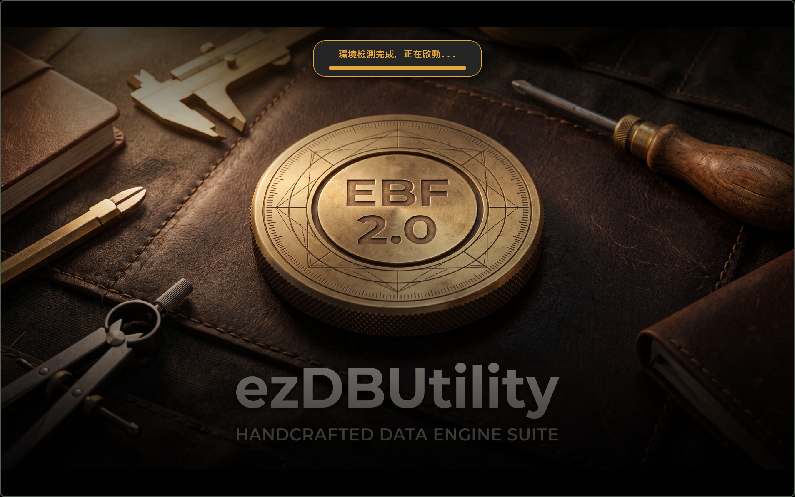 | 載入 ez_dbengine 實體引擎核心與環境檢查。 |
| **Schema 與 Tag 管理** | 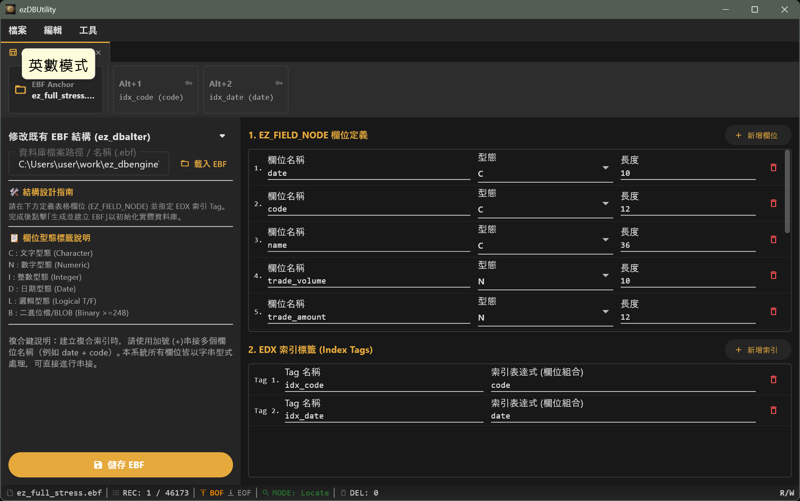 | 視覺化編輯 `EZ_FIELD_NODE` 欄位型態與多重 EDX 索引 Tag。 |
| **Relation Studio (關聯視圖)** | 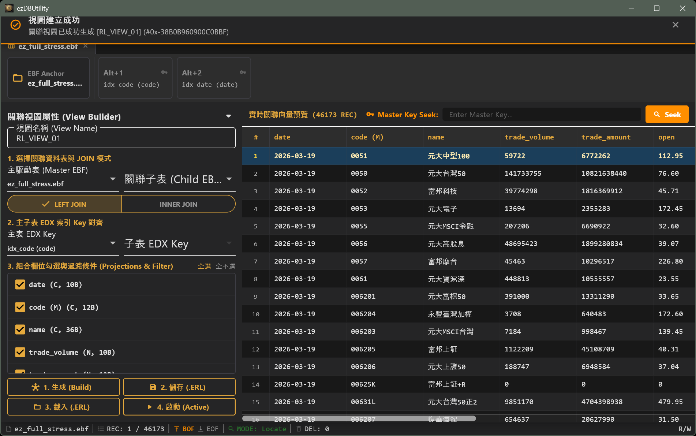 | 宣告式 Join 條件建構，支援自訂向量投影與 `.ERL` 匯出。 |
| **Data Grid 實體資料編輯** | 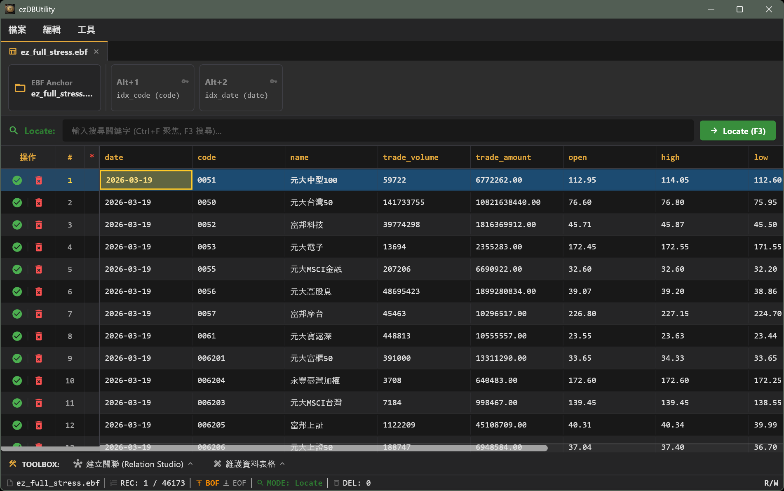 | 支援以 `Ctrl+F` 快速尋址、行級刪除 (DEL) 與高亮顯示。 |
|  |  |  |
| **Web 版 Schema 管理** | 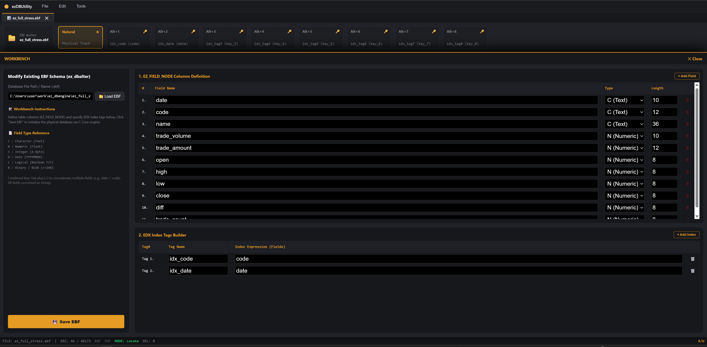 | 視覺化編輯 `EZ_FIELD_NODE` 欄位型態與多重 EDX 索引 Tag。 |
| **Web 版 Relation Studio (關聯視圖)** | 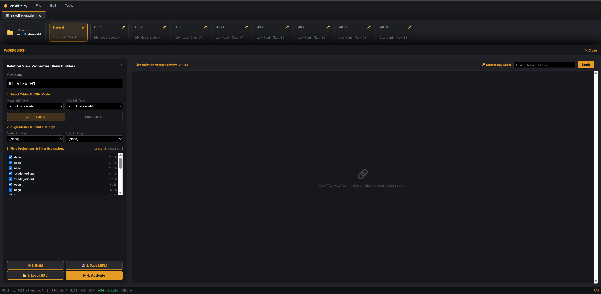 | 宣告式 Join 條件建構，支援自訂向量投影與 `.ERL` 匯出。 |
| **Web 版 主資料編輯** | 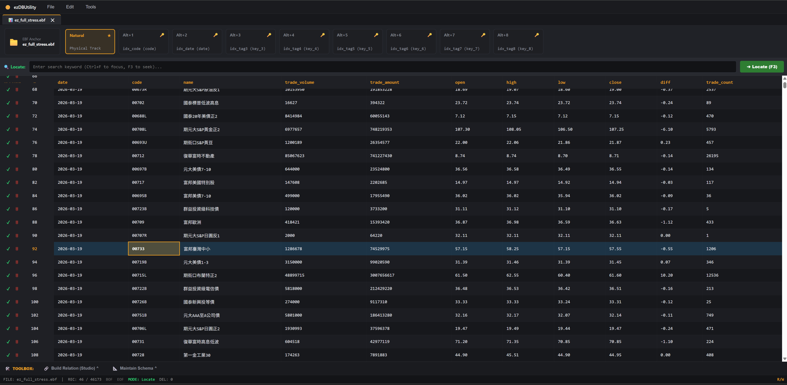 | 支援以 `Ctrl+F` 快速尋址、行級刪除 (DEL) 與高亮顯示。 |

---

## 🖥️ ez_Shell 控制台互動工具

全新推出的 GUI Console 管理具 **`ez_Shell`**，整合了資料庫結構演進、Tag 索引設計、實體數據網格編輯與 Relation Studio 多表關聯預覽：

| 畫面名稱 | 畫面展示 | 功能說明 |
| :--- | :---: | :--- |
| **操作 ez_Shell 畫面** | 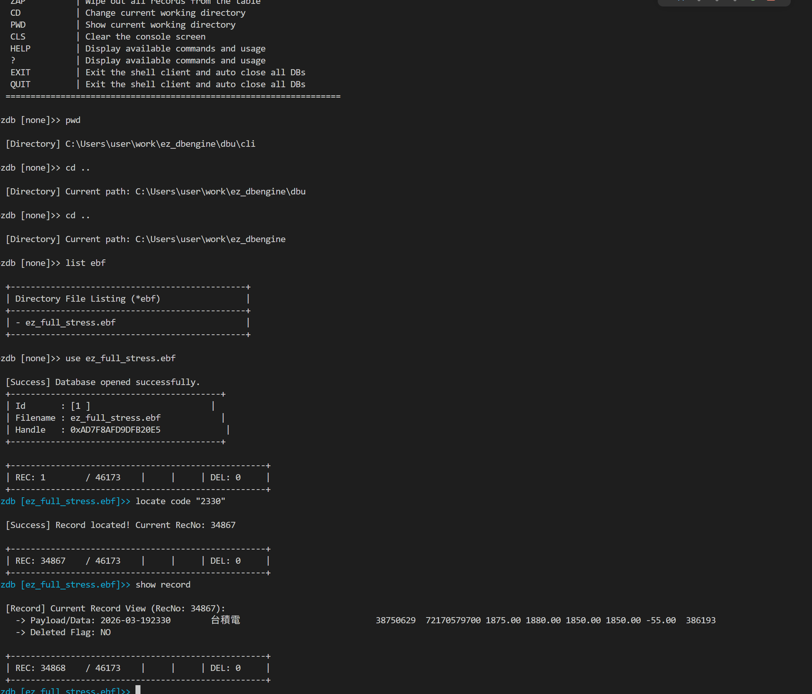 | 操作Console 模式 DBU |

---

## 🛠️ 跨語言 FFI 介面與 DBU 工具集

`ez_dbengine` 提供了完整的 DBU 運算與跨語言 Binding，讓各種技術棧皆能無縫存取底層 C 引擎的極速物理效能：

```text
ffi/
├── cpp/            # C++ Native Client & FFI Class Wrapper
├── cs/             # C# (.NET 9) P/Invoke SDK & DllImport Resolver
├── flutter/        # Flutter / Dart FFI GUI Dashboard (ezDBUtility)
├── node.js/        # Node.js (ffi-napi / koffi) Native Binding
├── php/            # PHP FFI Web Application & Admin Dashboard
├── python/         # Python ctypes High-Level Object Wrapper
└── rust/           # Rust Safe FFI Binding (RAII Drop & Struct Alignment)
```
---
## 📊 各語言 FFI 物理壓測實測 (4-Bucket 並行寫入)

所有測試皆基於相同的 4-Bucket 並行注入與實體檔案寫入 (`daily_2026-03-19.csv`，46,173 筆紀錄)：

| 語言 / 框架 | 介面模式 | 總注入筆數 | 總寫入耗時 (ms) | 吞吐量 (TPS) | 實測終端與儀表板畫面 |
| :--- | :--- | :---: | :---: | :---: | :---: |
| **C Core (Native)** | Direct C Call | 46,173 | **1,031.46 ms** | **44,764.50 TPS** |  |
| **C++ OO** | C++ Wrapper | 46,173 | **1,259.43 ms** | **36,661.79 TPS** | 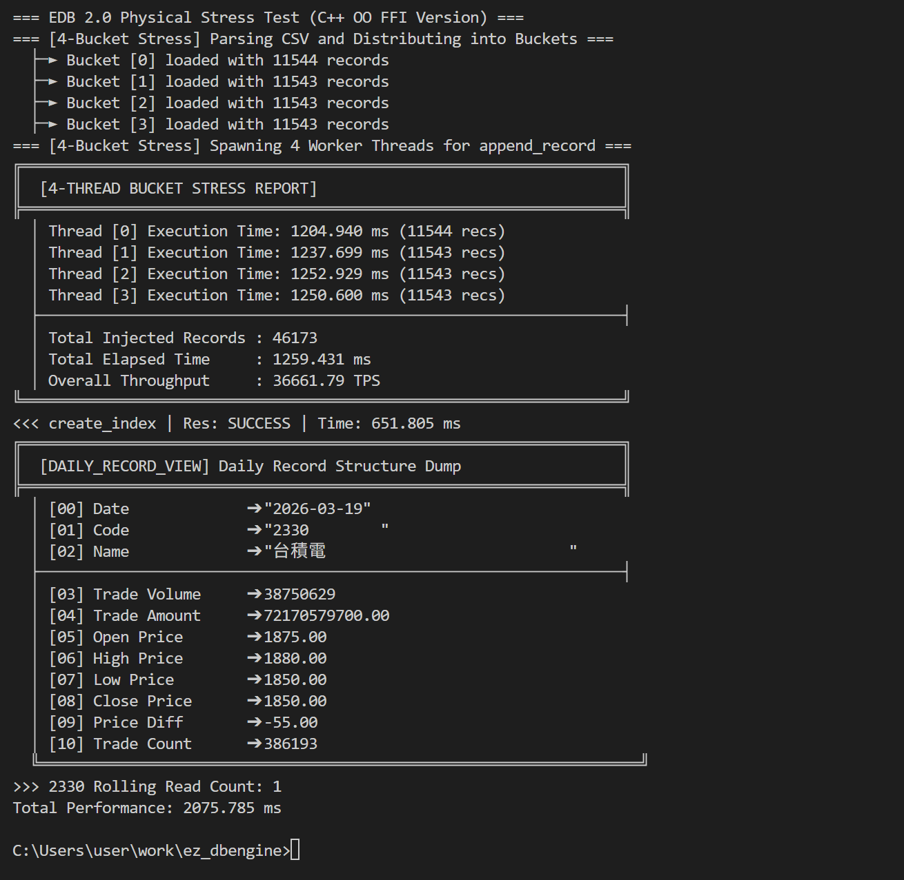 |
| **Flutter / Dart** | Dart FFI Isolate | 46,173 | **1,612.16 ms** | **28,640.42 TPS** | 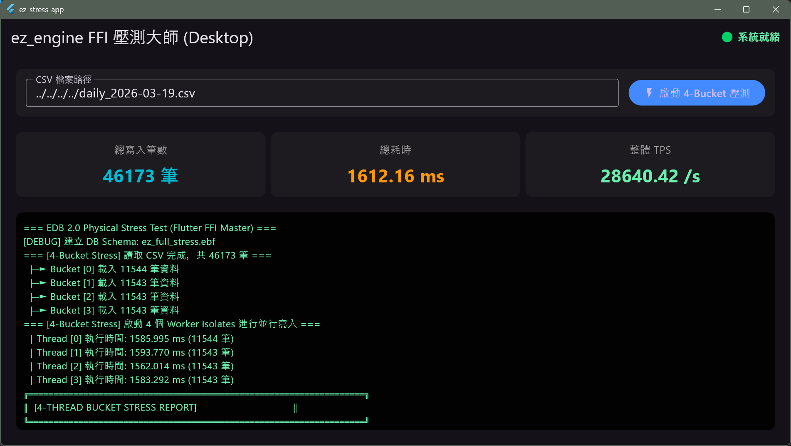 |
| **Python** | `ctypes` FFI | 46,173 | **2,138.12 ms** | **21,595.05 TPS** |  |
| **C# (.NET 9)** | P/Invoke Native | 46,173 | **2,764.37 ms** | **16,702.88 TPS** | 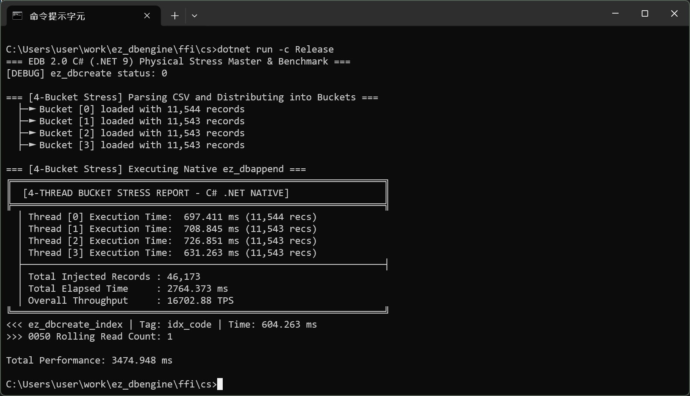 |
| **Node.js** | Native FFI | 46,173 | **3,328.90 ms** | **13,870.35 TPS** | 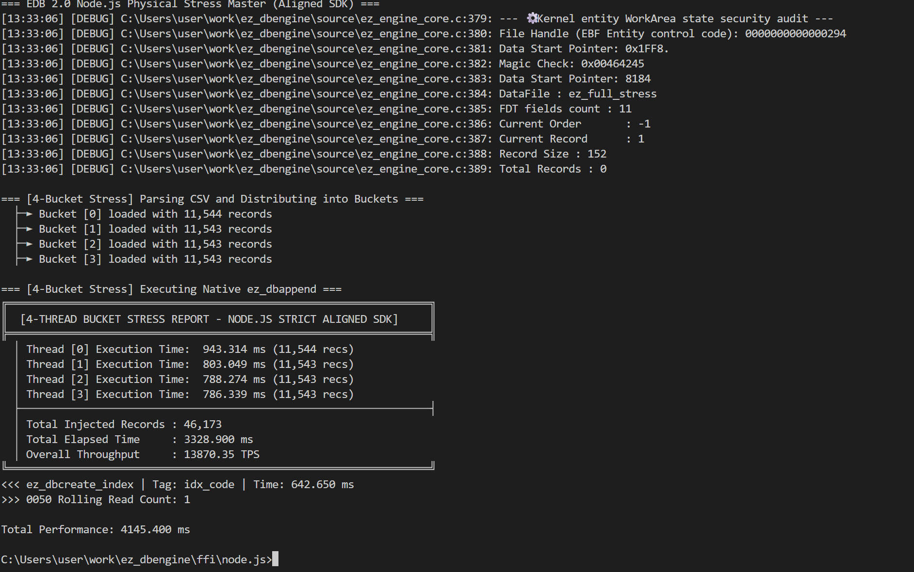 |
| **Rust** | Safe FFI Wrapper | 46,173 | **3,314.78 ms** | **13,929.41 TPS** | 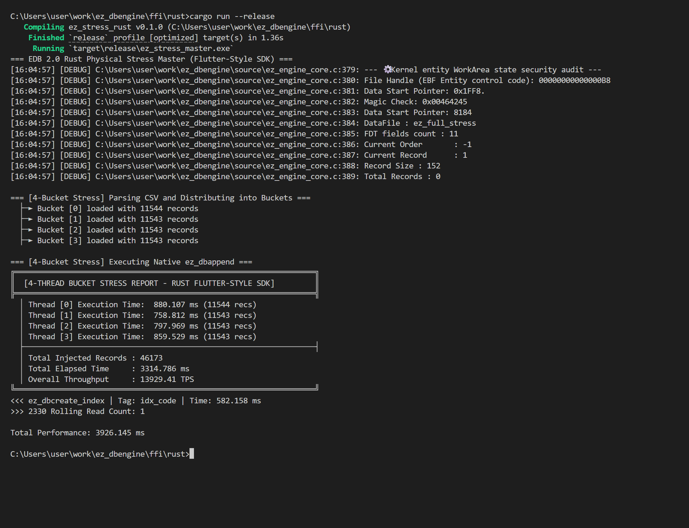 |
| **PHP (Web UI)** | PHP FFI + Dash | 46,173 | **3,815.17 ms** | **12,102.46 TPS** |  |


### 🛠️ 後續各語言 FFI 極限優化方針 (Optimization Roadmap)

針對目前落在 2.3 萬 ~ 2.6 萬 TPS 的語言，後續版本將進行以下無鎖與零拷貝重構：

#### 1. Rust SDK
- **消除熱路徑的 `CString` / `clone()`**：改用裸指標切片 `&[u8]`（`as *const c_char`），避免迴圈中 4.6 萬次微型 heap 分配。
- **解耦外層互斥鎖**：移除 `Arc<Mutex<...>>`，利用 C 核心先天的無鎖原子保留機制，讓 4 個 Worker 各自持有獨立 Raw Handle 並行直刷。
- **編譯啟用 LTO**：開啟 `lto = "fat"` 與 `codegen-units = 1` 榨乾編譯器最佳化。

#### 2. Node.js (Koffi)
- **大塊連續 Buffer 批次注入**：將單一 Bucket 的萬筆資料拼為單一 `Buffer` 指標傳遞，減少 V8 與 C 核心之間數萬次的跨界切換。
- **多執行緒隔離**：引入 `worker_threads` + `SharedArrayBuffer`，打破單執行緒事件循環競爭。

#### 3. PHP (Web FFI)
- **預分配連續 C 堆積**：使用 `FFI::new("char[N]")` 批次寫入，避免 Zend Engine 頻繁建立 `zval` 物件觸發 GC。
- **啟用 Opcache JIT**：在啟動參數加入 `-d opcache.enable_cli=1 -d opcache.jit=tracing`，將 FFI 呼叫就地轉譯為組合語言。

---

## 💡 核心設計理念

### 1. 直覺快速的資料操作語義
不再需要繁瑣的 SQL 語句組裝與 ORM 映射。ez_engine 提供原生、直覺的游標操作指令。這讓資料處理邏輯更加緊湊，特別適合需要對本地端大量數據進行逐筆掃描、即時計算的商務邏輯場景。
因為提供了高併發多工多緒模型 所以可以實現從EDGE到HOST端 處理資料

### 2. 終結「索引斷鍊」的歷史痛點
資料的處理最痛苦的是肥大的處理模型 很簡單的一個應用 都必需要背上很重且用不到的過度封裝功能 。本引擎採用了**自定義的強健索引資料結構**與**物理指紋驗證機制**，確保資料紀錄與索引標籤之間的絕對綁定。即使在異常斷電或頻繁寫入的情況下，也能維持索引的穩定性，大幅降低維護成本。呼叫 ez_dbuse 時，引擎會根據標頭定義自動掃描並掛載最多 8 組 .edx 檔案，徹底實現索引管理自動化。 

數據一致性物理鎖: ez_dbappend 嚴格校驗索引控點，若定義的索引檔缺失，將強制拒絕寫入，從根源確保數據與索引的絕對同步。

### 3.自適應非同步 I/O 實裝 作業系統級高併發 I/O 模型
傳統的區域資料庫受限於單執行緒的同步 I/O。`ez_engine` 在底層深度整合了現代作業系統的非同步噴射 I/O 技術，並針對不同核心提供自適應的降級機制：
* **Windows**: 支援  `IOCP` / `ReadFileEx`
* **Linux / Android**: 支援 cutting-edge `io_uring`, 並向下相容 高併發的 `posix` 無鎖機制.
* **macOS / iOS**: 支援  `POSIX`

透過底層 64 Slots 的環形緩衝 (Ring Buffer) 與 Lock-free 原子輪詢叫號機制，實現無阻塞的資料吞吐，讓本地資料處理速度（特別是在行動裝置的快閃記憶體上）達到硬體極限。

本系統將支援多工多緒的 操作 並新增了一些符合這些新增特性的函數功能 

---

### 📂 適用場景 (Suitable Use Cases)

本引擎最適合應用於：
* **Edge AI 資料注入 (Edge AI Data Ingestion)**：在進行進一步分析前，高速緩衝高頻感測器數據。
* **Host 端高併發微服務與後端核心 (Host-Side High-Concurrency Microservices)**：基於底層無鎖與多工多緒模型，在伺服器端或主機端充當極速資料運算核心與本機高吞吐快取儲存層。
* **嵌入式 / 本地儲存 (Embedded/Local Storage)**：無法部署笨重資料庫系統，但極度需要強健、具索引且高可靠本地儲存的場景。
* **效能關鍵核心元件 (Performance-Critical Components)**：對每毫秒延遲與每位元組記憶體佔用皆斤斤計較的極致系統。

---

## 🏗️ 系統架構圖


> **Figure 1**: ez_engine 物理儲存與非同步 I/O 引擎架構。展示了從前端 FFI (Flutter/Python/Rust) 到核心 16 個 WorkArea Slots，再透過 64-Slot Ring Buffer 噴射至各平台原生 I/O (io_uring/IOCP/POSIX ) 的完整流程。

## ✨ 底層技術特性

* **🧱 絕對物理對齊 (空間換取效率)**
  採用動態對齊長度推進IO效能，全表採用 `0x20` (Space) 實體填充，避免檔案系統空洞，所有紀錄根據結構大小，精確鎖定於 4K 因數邊界 (128B ~ 4096B)或4K倍數，實現極致的快閃記憶體分頁對齊。

* **🛡️ 物理指紋防禦 (FNV-1a)**
  每筆紀錄自帶 64-bit Hash 驗證。防禦範圍涵蓋 `_row_id`、`_timestamp` 與 `用戶數據區`，任何硬碟層級的靜默損壞皆無所遁形。

* **🔄 動態結構演進**

##  核心級別效能優化 (L1 快取與 CPU 對齊)

* 64 位元快取行對齊 (Cache Line Alignment)：所有核心數據結構均強制對齊至 64 位元邊界，確保紀錄完美鎖定在單一 L1 快取行中，極大化預取效率。

* 物理區塊分頁定位：採用 8KB 分頁對齊 與 4K 物理塊 鎖定，避免數據搬運過程中的記憶體碎片化，減少 CPU 等待週期。

* 硬體友善數據填充：使用 0x20 (Space) 進行實體填充，確保搜尋與讀取操作始終落在可預測的記憶體偏移量上。

### 📂 目錄結構

```text
.
├── test/             # 壓力測試與測試數據 (.ebf, .edx)
├── include/          # 公開標頭檔 (選用)
├── build_win/        # Windows 建構輸出
├── build_linux/      # Linux 建構輸出
├── build_android/    # Android 建構輸出
├── build_macos/      # Macos/iOS 建構輸出
├── ffi/              # Python & Flutter & Rust 操作介面 
├── dbu/cli           # ez_shell 工具
├── dbu/gui           # ez_dbutility 工具
└── docs/             # 文件/圖檔

```


## 📚 核心指令集 

本引擎的 API 設計高度資料操作 語義，並針對 C 語言特性進行了物理層級的優化。以下為核心支援的指令一覽：

### 📂 1. 資料庫與工作區管理 
| 函式 (API)        | 功能對應         | 說明 
| :---              | :---            | :---                               
| `ez_db_create`    | `CREATE`        | 建立全新 ebf 資料庫與 4K 物理標頭。
| `ez_db_use`       | `USE`           | 開啟資料庫，自動掛載 8 組影子索引，具備斷電自動修復機制。
| `ez_db_close_all` | `CLOSE ALL`     | 安全關閉所有工作區，同步釋放所有索引 Handle 防止洩漏。

### 🧭 2. 游標導航 
完全無縫接軌逐筆掃描哲學，結合 16 Physical WorkArea Slots 快取，導航幾乎是零延遲。

| 函式 (API)        | 功能對應          | 說明 
| :---              | :---             | :--- 
| `ez_db_gotop`     | `GO TOP`         | 游標移至首筆
| `ez_db_gobottom`  | `GO BOTTOM`      | 游標移至末筆
| `ez_db_skip`      | `SKIP n`         | 游標相對移動 n 筆 (支援正負數)。 
| `ez_db_goto`      | `GOTO n`         | 游標絕對定位至指定實體紀錄編號 (RecNo)。 
| `ez_db_eof`       | `EOF()`          | 判斷是否已達檔案尾端
| `ez_db_bof`       | `BOF()`          | 判斷是否已達檔案開頭。 
| `ez_db_recno`     | `RECNO()`        | 取得當前紀錄編號
| `ez_db_lastrec`   | `LASTREC()`      | 取得當前總筆數。 

### 📝 3. 資料操作與查詢 
所有的寫入與讀取皆受 **物理指紋** 保護，確保資料的絕對純淨。

| 函式 (API)            | 功能對應          | 說明 
| :---                  | :---             | :--- 
| `ez_db_seek_by_tag`   | `SEEK`           | O(log N) 極速二分搜尋，直接指定 NDX TagName 不需要 SELECT 。 
| `ez_db_seek_by_tag_id`| `SEEK`           | O(log N) 極速二分搜尋，直接指定 NDX TagId 不需要 SELECT。 
| `ez_db_append`        | `APPEND BLANK`   | 尾部新增紀錄，含索引缺失禁寫保護與自動 Hash 封裝。 [
| `ez_db_replace`       | `REPLACE`        | 更新指定欄位內容，並觸發 指紋重鑄。 
| `ez_db_rowreplace`    | `REPLACE`        | 更新整筆內容，並觸發 指紋重鑄。
| `ez_get_record`       | `Scatter Memvar` | 讀取當前紀錄的純淨 用戶數據，自帶 Hash 攔截防禦。 
| `ez_db_delete`        | `DELETE`         | 邏輯刪除 (標記 `_row_id` 最高位元)。 
| `ez_db_recall`        | `RECALL`         | 去除刪除 (標記 `_row_id` 最高位元)。 
| `ez_db_get_batch_alloc`| (現代擴充)        | 向量化批量交割，一次性提取大量匹配資料 (支援 1% 物理抽樣校驗)。 

### 🏗️ 4. 結構演進與維護 
| 函式 (API)            | 功能對應           | 說明
| :---                  | :---              | :--- 
| `ez_db_alter`         | `MODIFY STRUCTURE`| 動態修改欄位結構。自動判定輕量改名或啟動重量級重組。 
| `ez_db_pack`          | `PACK`            | 物理清除被邏輯刪除的紀錄，並重新壓實檔案。 
| `ez_db_reconstruct`   | (引擎底層)         | 處理資料搬家、Offset 重新映射與 索引同步重生 的核心重組器。
| `ez_db_commit`        | `COMMIT`          | 將 WorkArea 中髒掉的 4K Header 強制噴射同步至硬碟 (fsync)。 

### 🗂️ 5. 索引建立與管理 
解決傳統索引易損壞的痛點。本引擎採用與 物理指紋深度綁定的 `.edx` 結構，確保資料庫 (`.ebf`) 與索引檔 (`.edx`) 之間的絕對一致性。


**【.edx 實體節點規格】**
每個索引節點 (Node) 長度固定為 `Key_Length + 8 Bytes`：

* `Key`：實體萃取出的欄位值 (例如 10B 的字串)。
* `RowID` (8B)：對應 `.ebf` 中的 `_row_id`，確保 100% 精確定位。

| 函式 (API)            | 功能對應           | 說明 
| :---                  | :---              | :--- 
| `ez_db_create_index`  | `INDEX ON`        | **【造樹】** 掃描 `.ebf` 實體資料，萃取 `[Key + RowID]` 於記憶體中排序後，連續寫入 `.edx` 檔。完成後，將該 `.edx` 的實體起點 (`root_ptr`) 與筆數 (`node_count`) 寫回 `.ebf` 的 4K 標頭 (`inline_tags`) 陣列
| `ez_db_reindex`       | `REINDEX`         | **【自癒】** 讀取 `.ebf` 標頭中記錄的所有索引定義，無視現有的 `.edx` 檔案，強制重新掃描 `.ebf` 128B 磚塊，並由上而下覆寫重建所有 `.edx` 檔案，達成物理級的斷鍊修復。

---

## 🔗 Relation Studio 子系統 API (ez_relation_mgr.h)

`ez_dbengine` 內建了 **Relation Studio 關係檢視子系統**，支援跨表 Join（`LEFT JOIN` / `INNER JOIN`）、單字碼與複合鍵（Composite Keys）關聯校驗，以及將檢視佈局導出/導入為 `.ERL` 二進位規格檔。

### 1. 核心資料結構 (Declarative Descriptors)

| 結構體名稱 | 說明 |
| :--- | :--- |
| `EZ_RL_NODE_DESC` | **欄位投影描述符**：定義來源 EBF 欄位及其在 View 中的別名 (`alias_name`)。 |
| `EZ_RL_LINK_DESC` | **外鍵關聯描述符**：定義 Parent/Child EBF 的鍵幾何，支援最多 8 組欄位組合鍵。 |
| `EZ_RL_VIEW_DESC` | **宣告式 View 描述符**：單次一次性描述關聯名稱、Join 模式、繫結 EBF 控點與投影/鏈結陣列。 |
| `EZ_ERL_FILE_HEADER` | **.ERL 視圖檔案標頭**：存儲 4 Byte Magic (`0x004C5245`) 與結構定界中態元資料。 |

---

### 2. 關係檢視生命週期與查詢 API (Lifecycle & Query APIs)

| 函式 (API) | 功能對應 | 說明 |
| :--- | :--- | :--- |
| `ez_rl_mgr_init` | `INIT REL MGR` | 初始化全域 Relation Manager 核心模組與控點地圖。 |
| `ez_rl_mgr_cleanup` | `CLEANUP REL MGR` | 清理並釋放 Relation Manager 佔用的全域系統資源。 |
| `ez_rl_build_view` | `CREATE VIEW` | **一鍵宣告式建構**：審核鍵幾何與外鍵鏈結，註冊並回傳 View 控點 (`h_rel`)。 |
| `ez_rl_destroy_view` | `DROP VIEW` | 銷毀關聯 View 控點並自動釋放相關記憶體（提供 `ez_rl_unregister` 巨集別名）。 |
| `ez_rl_get_record_vector` | `FETCH VECTOR` | 自關聯視圖一次性提取多筆拼合後的實體 Record 向量 Payload。 |
| `ez_rl_save_view_file` | `EXPORT .ERL` | 將 `EZ_RL_VIEW_DESC` 定義匯出並持久化儲存為二進位 `.ERL` 視圖檔案。 |
| `ez_rl_load_view_file` | `IMPORT .ERL` | 讀入 `.ERL` 檔案並與實體 EBF 控點陣列動態繫結，迅速生成 View 控點。 |

---

### 物理資源生命週期

(_platform_close 確保 _runtime_res 池中的 8 組索引控點完全關閉，防止在頻繁開關資料庫時耗盡系統資源。)

### 🚀 現代化操作建議 (Modern Best Practices)

為了發揮 `ez_dbengine` 的 Jet Mode 物理噴射效能，建議開發者轉向「原子化、整筆處理」的現代 API 設計：

| 操作場景 | 傳統 (Legacy) | EZENGINE 0.9 推薦 (High Performance) | 效能與安全優勢 |
| :--- | :--- | :--- | :--- |
| **新增資料** | APPEND BLANK + REPLACE | **ez_dbappend(data_ptr)** | 原子性寫入，避免中間態髒數據。 |
| **索引搜尋** | SET ORDER TO + SEEK | **ez_dbseek_by_tag_id(id, key)** | 無狀態尋址，適合多執行緒。 |
| **更新資料** | 逐一欄位 REPLACE | **ez_dbrowreplace(data_ptr)** | 指紋重鑄，實現 4K 區塊高速更新。 |
| **快速查詢** | SELECT + SEEK | **ez_dbseek_by_tag(name, key)** | 解耦操作，降低程式碼耦合度。 |

## 💡 為什麼要這樣設計？
這套 API 的演進是為了對應現代作業系統的核心技術：
減少系統調用 (Syscall)：ez_dbappend 直接將完整數據包送入 統一的io高併發無鎖底層，避免了多次小筆寫入導致的內核上下文切換。  
物理指紋保護：整筆處理確保了 SHA-256 握手與 FNV-1a 雜湊能涵蓋完整的數據生命週期。 
數據一致性物理鎖：ez_dbappend 最終校驗索引控點，若索引缺失將強制拒絕寫入，從根源確保數據與索引絕對同步。  


## 🖥️ 開發與基準測試環境 (Development & Benchmark Environment)

本專案之效能基準測試與除錯驗證均在以下實體硬體環境中完成：

| 項目 (Item) | 規格細節 (Specification) |
| :--- | :--- |
| **主機型號 (Device)** | Lenovo ThinkPad X1 Carbon (6th Gen)  |
| **處理器 (CPU)** | Intel(R) Core(TM) i7-8650U @ 1.90GHz (4 Cores / 8 Threads) |
| **記憶體 (RAM)** | 16.0 GB LPDDR3 (15.8 GB 可用) |
| **作業系統 (OS)** | Windows 11 專業版 64-bit (Version 25H2, OS Build 26200.9168) |
| **架構類型 (Arch)** | x86_64 (x64-based processor) |
| **編譯工具鏈 (Toolchain)** | MSVC (Visual Studio 2022 / C++20) & MinGW-w64 GCC |